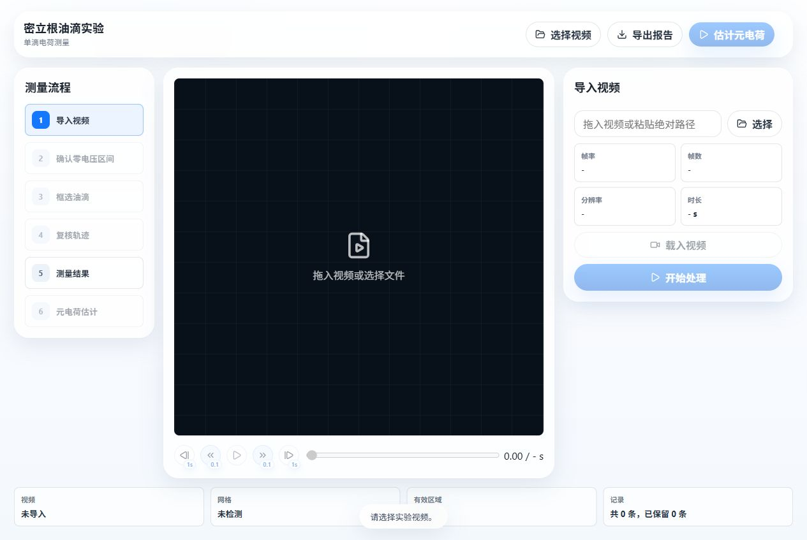
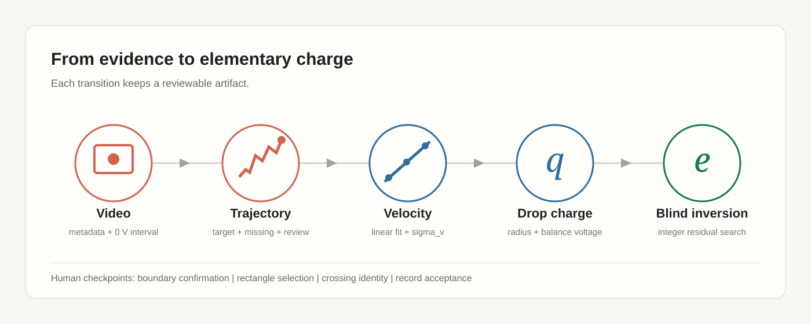
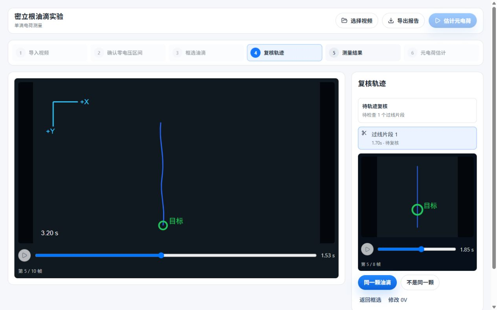
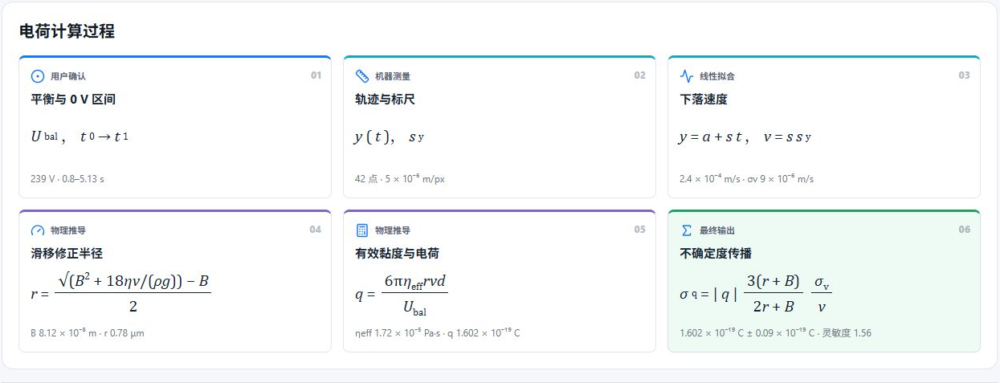
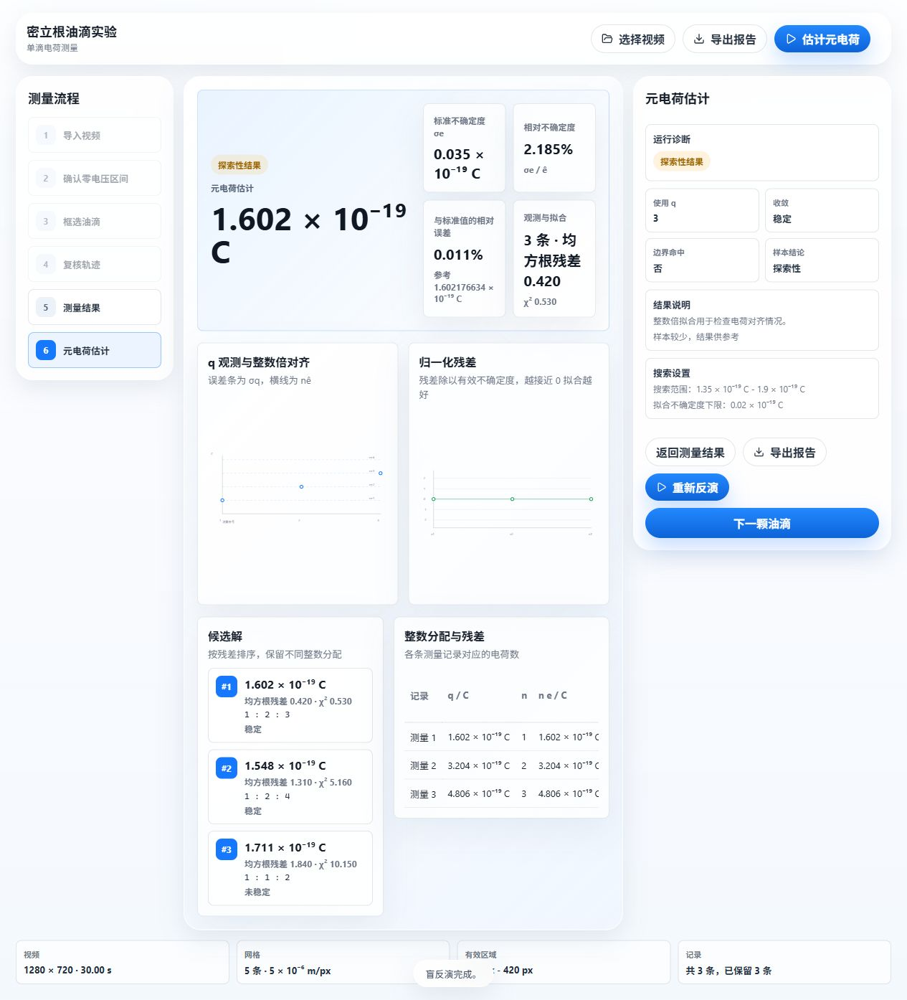
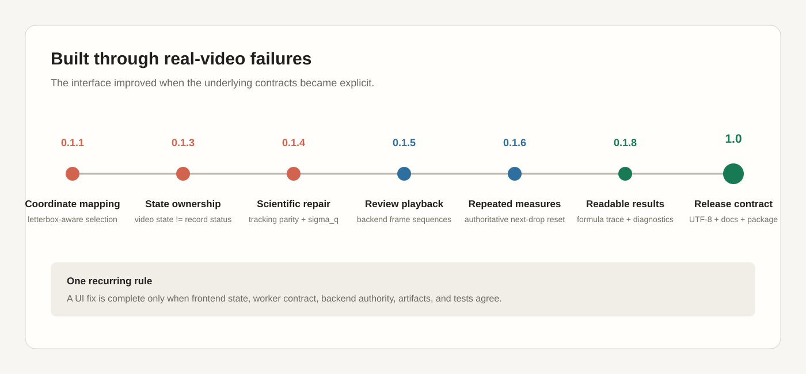

# Millikan AI

**Desktop software for the Millikan oil-drop experiment.**

**Presented by Xinchen Lee & Minghao Yao**

Millikan AI helps students measure oil drops from video. It guides the user
through selecting a droplet, reviewing its trajectory, calculating its charge,
and estimating the elementary charge from accepted measurements.

*Screenshots use built-in demo data.*

## Get the app

- **Download:** [Windows 0.9.2 build](https://github.com/teddyli18000/AiForMillikan/actions/runs/43032106593#artifacts) — download and unzip `millikan-ai-normal-portable` under Artifacts after the build passes.
- **Test video:** [open the Releases page](https://github.com/teddyli18000/AiForMillikan/releases/tag/videos) or [attached to each version](https://github.com/teddyli18000/AiForMillikan/releases/latest)
- **Documentation:** [Technical and academic documentation](normal/docs/README.md)

The portable EXE is unsigned, so Windows SmartScreen may ask for confirmation.

## Measurement workflow

The measurement uses a balance voltage and the falling interval at `0 V`.

1. Import a video and confirm the `0 V` interval.
2. Set the balance voltage and select one droplet.
3. Review its trajectory and grid crossings.
4. Check the fitted velocity, radius, charge, and uncertainty.
5. Accept the result; repeat for other droplets or videos.
6. Estimate the elementary charge from at least three accepted results.

### Trajectory review

Review tracked positions and crossing assignments against the video.

### Charge calculation

The calculation shows the fitted speed, Cunningham correction, radius, charge,
and propagated fit uncertainty.

### Elementary-charge estimate

The estimate compares accepted drop charges with integer multiples of a
candidate elementary charge. Results from three drops are exploratory.

## Applications

| Route | Purpose | Status |
| --- | --- | --- |
| **Normal** | One user-selected droplet at a time; human review; transient session; blind inversion | Recommended |
| **Experimental** | Automatic multi-drop and multi-platform research pipeline | Experimental |

Each application has its own frontend, worker, and tests.

## Building the product

The diagram summarizes major changes during development.

### Design changes

| Problem | Fix |
| --- | --- |
| Selection rectangles drifted | Compensate for video letterboxing. |
| Confirmed intervals were lost on reopen | Restore the confirmed boundaries. |
| Review clips failed to play | Generate and display review frames. |
| A new droplet reused the previous track | Reset tracking before selecting again. |
| Pressure values differed across screens | Use one physical-constant source and report pressure in kPa. |
| `sigma_q` missed fit error | Propagate slope uncertainty through `q(v)`. |

## Run from source

Each application has its own setup and build instructions: [Normal](normal/README.md)
and [Experimental](experimental/README.md).

## Contributors

- [Xinchen Lee](https://github.com/teddyli18000) — product concept, workflow and
  system architecture, desktop application, scientific integration, and release
  engineering.
- [Minghao Yao](https://github.com/teddyli18000/AiForMillikan/graphs/contributors) —
  experimental data and video collection, plus the local Trackpy tracking
  prototype used to validate the main single-droplet tracking direction.

<!-- Replace the teammate contributors link with a personal profile when available. -->

## Academic method

For a balanced droplet, electric force balances effective weight. A linear fit
to its vertical position during the confirmed `0 V` interval gives the falling
speed. The Cunningham correction is used to find the radius, then the balance
voltage gives the droplet charge.

The blind inversion compares measured charges with integer multiples of a
candidate elementary charge and refines the estimate using uncertainty weights.

The derivations and contracts are documented in:

- [Experiment method](normal/docs/academic/experiment-method.md)
- [Single-drop charge calculation](normal/docs/academic/charge-measurement.md)
- [Uncertainty model](normal/docs/academic/uncertainty.md)
- [Blind inversion](normal/docs/academic/blind-inversion.md)
- [Scientific boundaries](normal/docs/academic/scientific-boundaries.md)

## Scientific boundaries

- The experimenter confirms that the droplet is balanced.
- `sigma_q` includes velocity-fit uncertainty, but not uncertainty in physical
  parameters.
- An inversion with three accepted charges is exploratory; it does not establish
  charge quantization.

See the [technical documentation](normal/docs/technical/architecture.md) for
implementation details.

## License

This project is licensed under the MIT License. See the [LICENSE](./LICENSE) file for details.
