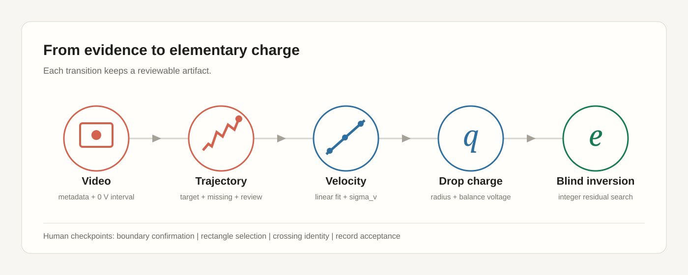

# Millikan AI Experimental

**Version 0.1.0** — the research app for automatic multi-drop, multi-platform
Millikan analysis.

Experimental is an intentionally half-finished research route. It is kept
separate from the recommended Normal workflow and must not drive Normal design
decisions. It analyzes a whole video, detects voltage-platform boundaries from
visual display changes, tracks multiple droplets, fits terminal velocities,
computes per-drop charges, and runs the bounded elementary-charge estimator over
every successfully computed q.



## Workflow

1. Open or drag in an experiment video.
2. Confirm the number of voltage platforms and enter voltage values, or accept
   auto-detected boundary suggestions.
3. Run the automatic analysis.
4. Inspect the run directory, candidate ranking, per-platform fits, multi-drop
   results, and elementary-charge diagnostics.
5. Export the run package, optionally as a ZIP or PDF.

## Layout

```
experimental/
├── apps/desktop/              # Electron + React analysis workspace
├── src/millikan_ai/           # Experimental Python package and worker
├── configs/default.yaml       # thresholds and physical constants
├── tests/                     # Experimental Python tests
├── scripts/                   # estimator validation harness, encoding check
├── docs/                      # contracts, academic notes, archive
├── run_millikan.py            # interactive local runner
├── training_quality_filter/   # future ML quality-filter research
├── pyproject.toml
└── AGENTS.md
```

## CLI

```powershell
cd experimental
.venv\Scripts\python -m millikan_ai.cli inspect ..\media\videos\2u.mp4
.venv\Scripts\python -m millikan_ai.cli analyze --video ..\media\videos\2u.mp4 --config configs\default.yaml --auto-platform-count 3 --platform-value 0 --platform-value 175 --platform-value 239
```

## Build and test

```powershell
cd experimental
python -m venv .venv
.venv\Scripts\python -m pip install -e ".[dev]"
.venv\Scripts\python -m pytest tests -q

cd apps\desktop
npm ci
npm test
npm run build
npm run worker:build
npx electron-builder --win portable
```

The portable artifact is `Millikan-AI-Experimental-Portable-0.1.0.exe`.

## Known limitations

- Automatic platform boundaries are suggestions. Short platforms or count
  mismatches must fall back to manual input rather than silently entering q
  calculation.
- Voltage values are user-supplied. There is no OCR on this route.
- The runtime quality adapter is a deterministic mock rule adapter
  (`mode=mock_rule_adapter`, `trained=false`); no trained ML filter is shipped.
- Results are research diagnostics, not a validated production measurement.

## Documentation

- [Frontend/backend contract](docs/frontend_backend_interface.md)
- [Architecture](docs/technical/architecture.md)
- [Validation](docs/technical/validation.md)
- [Encoding, build, release](docs/technical/encoding-build-release.md)
- [Raw video smoke records](docs/raw_video_smoke.md)
- [Academic notes](docs/academic/)
- [Historical designs](docs/archive/)

## License

MIT. See [../LICENSE](../LICENSE).
