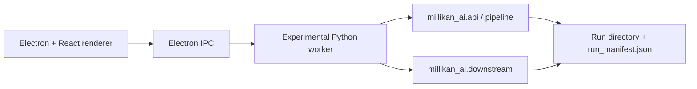

# Experimental Architecture

The Experimental app is a Windows portable Electron application backed by a
project-local Python worker. It analyzes a whole video with automatic multi-drop
tracking and a bounded elementary-charge estimator.

## Processes

### Renderer

`apps/desktop/src/` owns the setup, analysis, and results views: platform table,
progress, overlay layers, validity checks, multi-drop tables, elementary-charge
diagnostics, charts, and export.

### Electron main

`apps/desktop/electron/` owns video and run-directory dialogs, Experimental IPC
dispatch, worker startup, progress forwarding, report export, and maximum-width
window on startup.

### Python worker

`src/millikan_ai/desktop_worker.py` speaks UTF-8 JSON Lines and exposes
`video.inspect`, `platform.detectBoundaries`, `analysis.run`,
`analysis.runAuto`, `analysis.loadRun`, `analysis.validate`, `downstream.run`,
and `report.export`.

It does not import the Normal package and does not expose `normal.*`
operations.

## Source of truth

- The run directory and `run_manifest.json` are the frontend entry point.
- CSV, JSON, and MP4 artifacts are the machine-readable contract.
- The renderer displays artifacts and never recomputes physics.

## Storage

Every analysis writes a run directory. The packaged app passes
`MILLIKAN_RUN_ROOT` to the worker, pointing at Electron's `userData/runs`
directory (`%APPDATA%\millikan-ai-experimental-desktop\runs` on Windows). The
worker also falls back to `%LOCALAPPDATA%\MillikanAI\Experimental\runs` when it
is started directly from a packaged build. Development runs use
`experimental/runs`. `load_config` applies the environment override to
`project.run_root`, so manual configs, analysis outputs, and downstream
artifacts all land in the same persistent root.

The "open run" dialog starts at that root, so earlier runs remain accessible
after the portable app is restarted. Users export a package through
`report.export`, optionally as a ZIP or PDF.
