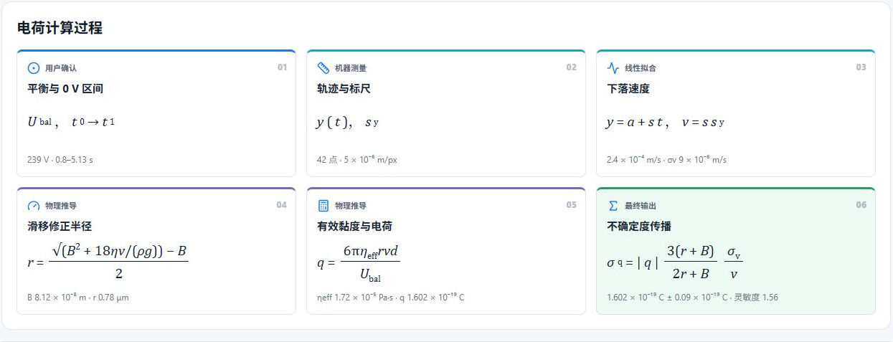
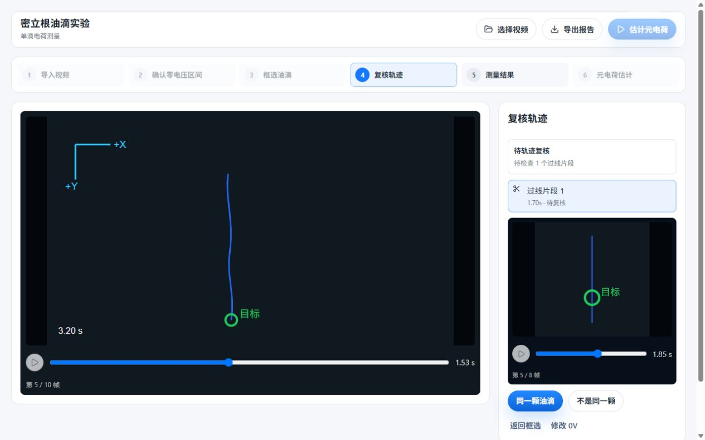

# Millikan AI Normal

**Version 0.9.1** — the mainline human-in-the-loop measurement app for the
Millikan oil-drop experiment.

Normal follows the traditional balance-voltage plus `0 V` falling method and
keeps every consequential decision visible. The app suggests where to look,
tracks one selected droplet, asks the experimenter to review ambiguous grid
crossings, calculates a single-drop charge with an explicit uncertainty trace,
and performs a blind integer-residual search after at least three accepted
measurements.

The AI value proposition is intelligent assistance with inspectable evidence,
not an unreviewed automatic answer.



## Workflow

1. Import a video by file dialog or drag-and-drop. The app shows fps, frame
   count, resolution, and duration.
2. Confirm the `0 V` falling interval with `±1 s` and `±0.1 s` controls.
3. Select the target droplet inside `0V_start_s ± 0.5 s`.
4. Track the droplet locally with Trackpy and review the full trajectory.
5. Review every crossing event with backend-generated review frames.
6. Accept or reject the q record and inspect the calculation chain.
7. After three accepted q records, run the Normal blind inversion.
8. Export the transient session before closing the app.




## Layout

```
normal/
├── apps/desktop/           # Electron + React renderer and main process
├── src/millikan_ai/        # Normal Python worker and millikan_ai.normal package
├── tests/                  # Normal-only Python tests
├── docs/                   # Normal contracts and physics notes
├── pyproject.toml
└── AGENTS.md
```

## Build and test

```powershell
cd normal
python -m venv .venv
.venv\Scripts\python -m pip install -e ".[dev]"
.venv\Scripts\python -m pytest tests -q

cd apps\desktop
npm ci
npm test
npm run build
npm run worker:build
npx electron-builder --win portable
```

The portable artifact is `密立根油滴实验-0.9.1.exe`.

## Scientific boundaries

- One droplet at a time. Multi-drop statistics are not a Normal feature.
- q comes from the balance-voltage plus `0 V` falling method, with uncertainty
  propagated from the linear-regression slope and q(v).
- The blind inversion reports `e_hat_C`, `sigma_e_C`, candidate solutions,
  integer assignments, and residuals. It does not claim a quantized model
  winner while the continuous baseline is not fitted.
- With fewer than three accepted q records the app reports insufficient
  evidence instead of inventing an estimate.

## Documentation

- [Frontend/backend contract](docs/frontend_backend_interface.md)
- [Normal workflow](docs/technical/normal-workflow.md)
- [Tracking and review](docs/technical/tracking-and-review.md)
- [Architecture](docs/technical/architecture.md)
- [Academic notes](docs/academic/)
- [Desktop build notes](docs/desktop_frontend.md)

## License

MIT. See [../LICENSE](../LICENSE).
