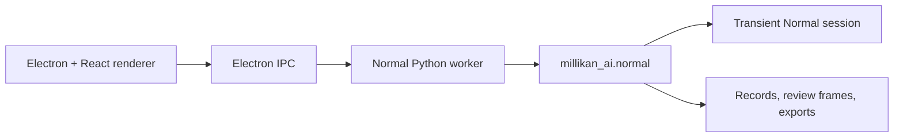

# Normal Architecture

The Normal app is a Windows portable Electron application with a project-local
Python worker. It measures one droplet at a time and keeps every consequential
step inspectable.

## Processes

### Renderer

`apps/desktop/src/` owns the five-stage workspace: import, `0 V` boundary,
target selection, tracking/crossing review, results, and the inversion page.
It never reads arbitrary local files directly and never recomputes physics.

### Electron main

`apps/desktop/electron/` owns:

- file dialogs and drag-and-drop path resolution;
- Normal-only IPC dispatch;
- starting the Python worker;
- forwarding Normal progress events;
- maximum-width window on startup;
- deleting implicit transient session roots on exit.

### Python worker

`src/millikan_ai/desktop_worker.py` speaks UTF-8 JSON Lines and exposes exactly
twelve operations: `normal.initialize`, `normal.inspectVideo`,
`normal.prepareVideo`, `normal.confirmBoundary`, `normal.selectTarget`,
`normal.saveMeasurement`, `normal.prepareCrossingReview`, `normal.reviewCrossing`,
`normal.updateRecordSelection`, `normal.startNextDroplet`,
`normal.runInversion`, and `normal.exportSession`.

It does not import the Experimental API, pipeline, tracker, segmenter, physics,
elementary estimator, or downstream module.

## Source of truth

- Video metadata, boundary, grid, target, track, crossing, fit, q, and inversion
  results come from the Python session or record.
- The renderer keeps interaction drafts only.
- Track and review images are generated by the backend in original video pixel
  coordinates. The renderer plays them and does not redraw coordinates.
- Advanced physical parameters are sparse per-record overrides; defaults come
  from `src/millikan_ai/normal/config.py`.

## Storage

The session is transient per app launch. `normal.initialize` without an explicit
`session_root` creates a fresh session and never reloads old records. One launch
may accumulate accepted q records across multiple videos. Explicit export is
the only long-term retention path.
